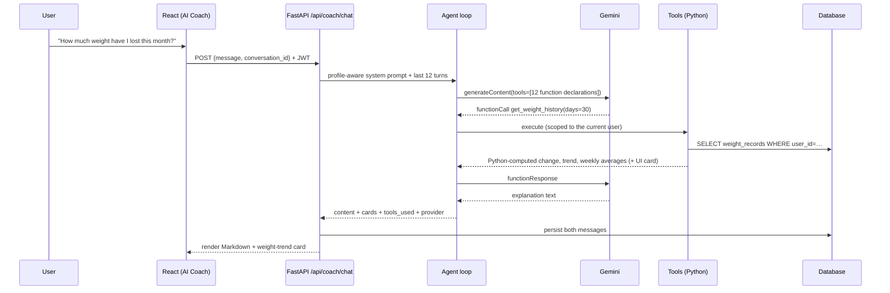

# FitAI Architecture

## System diagram

```
┌──────────────────────────────── Browser (React SPA) ───────────────────────────────┐
│  Pages: Dashboard · Coach · Diet · Workouts · Nutrition · Progress · Settings       │
│  components/ui (design system) · charts (Recharts) · context (Auth, Toast)          │
│  services/api.ts  ── fetch /api/* with JWT (no secrets in the browser) ──┐          │
└──────────────────────────────────────────────────────────────────────────┼──────────┘
                                         Vite dev proxy / nginx (prod)    │
┌────────────────────────────────── FastAPI backend ───────────────────────▼──────────┐
│  routers/  auth · profile · dashboard · coach · diet · workouts · nutrition ·        │
│            progress · settings · health      (JWT dependency, Pydantic validation)   │
│      │                         │                                │                    │
│      ▼                         ▼                                ▼                    │
│  services/ (business logic)   ai/agent.py ─── tool loop ───►  tools/ (registry)      │
│  fitness_service  (BMR/TDEE/   │  provider.py (abstraction)     calculate_* ,        │
│    macros — deterministic)     │   ├ gemini.py  (REST + fn       get_* , generate_*, │
│  nutrition_service (OFF,       │   │  calling, retries,          search_food,        │
│    meal engine, balancing)     │   │  fallback model)            save_recommendation │
│  workout_service (programming, │   ├ groq.py   (OpenAI-compat)   analyze_progress    │
│    wger enrichment)            │   └ mock.py   (labelled demo)        │              │
│  progress_service (trends,     │  prompts.py (system + safety)        │              │
│    plateaus, streaks, badges)  │                                      ▼              │
│  demo_service (sample data)    └──────────────► services + DB  ◄──────┘              │
│      │                                                                               │
│      ▼  SQLAlchemy 2 ORM                                                             │
│  SQLite (local)  ⇄  PostgreSQL (production, same models)                             │
└──────────────────────────────────────────────────────────────────────────────────────┘
          │ httpx (timeouts, TTL cache, rate limits, graceful fallback)
          ▼
   Google Gemini API · Groq API · Open Food Facts · wger
```



## Separation of concerns

| Concern | Where | Rule |
|---|---|---|
| AI reasoning | `ai/agent.py`, `ai/prompts.py` | Chooses tools and explains results. Never computes user numbers |
| Business logic | `services/*` | Plans, analysis, safety floors, achievements |
| Data retrieval | `tools/*`, `services/*` via SQLAlchemy | Every query is filtered by `user_id` |
| Deterministic calculations | `services/fitness_service.py`, `progress_service.py` | Mifflin-St Jeor, TDEE multipliers, regression trend, weekly averages |
| User interface | `frontend/src` | API calls only in `services/`; UI is presentational |

## AI design

- **Provider abstraction** (`ai/provider.py`): `start`, `step`, `add_tool_results` and `generate_json`. Each provider keeps its native history, so Gemini's `thoughtSignature` parts are echoed back verbatim during function calling.
- **Resolution:** user preference → `AI_PROVIDER` → Gemini (if keyed) → Groq (if keyed) → Mock.
- **Resilience:** exponential backoff on 429 and 5xx, a fallback model, then a labelled demo response. Per-user AI rate limit of 20 a minute.
- **Tools (12):** `get_user_profile`, `calculate_bmr`, `calculate_tdee`, `calculate_calorie_target`, `calculate_macros`, `get_weight_history`, `get_daily_nutrition`, `get_workout_history`, `generate_workout`, `search_food`, `save_fitness_recommendation`, `analyze_progress`. Each tool returns data for the model and a `_card` for the UI. The card is stripped before the result goes to the LLM.
- **Grounding:** the system prompt forbids inventing numbers and lists safety rules (no extreme deficits, no diagnoses, no supplement or medication claims, no outcome guarantees, and referral to professionals).
- **Diet planner:** with an LLM, meals come back as JSON validated by Pydantic-style normalisation, totals are recomputed in Python, and values are labelled *AI-estimated*. Without an LLM, or if it fails, the reference engine picks meal templates for the diet and restrictions, scales portions, then runs `balance_macros` (portion tuning toward the protein target and fat trimming) using reference nutrition values.
- **Workout generator:** a deterministic programming engine (split selection, equipment filtering, set, rep and rest prescriptions). The LLM adds a coaching note.
- **Progress analysis:** `progress_service.full_analysis` computes facts, and the LLM may only narrate them.

## Database design

```
users ─┬─< fitness_profiles (1:1)        all body values stored metric
       ├─< weight_records                (user_id, recorded_on) indexed
       ├─< body_measurements             waist/chest/hips/arm/thigh
       ├─< food_entries                  (user_id, eaten_on) indexed → daily nutrition records are aggregations
       ├─< diet_plans                    targets, preferences, meals (JSON), generated_by, is_saved
       ├─< workout_plans                 split, inputs, days (JSON), generated_by, is_saved
       ├─< workout_sessions              workout history: started/completed, duration, exercises (JSON)
       ├─< conversations ─< messages     role, content, cards (JSON), tools_used, provider
       ├─< saved_recommendations         coach saves + cached daily recommendation
       └─< user_achievements             UNIQUE(user_id, code)
```

All child tables use `ON DELETE CASCADE` foreign keys and `created_at`/`updated_at` timestamps. Schema initialisation is `Base.metadata.create_all` at startup, which is idempotent. For production schema evolution, add Alembic (see DEPLOYMENT_GUIDE.md). JSON columns map to `JSON`/`JSONB` on PostgreSQL.

## Security

- bcrypt (cost 12) password hashing, HS256 JWTs with expiry, and a Bearer dependency on every protected router.
- Per-resource ownership checks return 404 for other users' records, so IDs can't be enumerated.
- Pydantic validation with bounds on every input, and centralised exception handlers that keep stack traces out of responses.
- CORS allow-list, rate limits on auth (20 a minute per IP) and AI (20 a minute per user), no secrets in the frontend or logs, and `.env` git-ignored.

## Frontend design system

Tokens are in `tailwind.config.js`: ink backgrounds `#0B0D0C` / `#111512` / `#171C18`, lime `#C6F36B` for primary actions and progress, moss `#49B675`, text `#F5F7F2` / `#9CA69D`, and borders `#29312B`. The type pairing is Manrope for display and Inter for UI. Components live in `components/ui`: Button, Card, Field, Segmented, Chip, OptionCard, Ring, Bar, MacroRow, Modal, Toast, Skeleton, EmptyState, ErrorState, Badge, Notice, Photo and Celebration. Motion comes from staggered fade-ups, animated rings, bars and count-ups, and chart transitions, and respects `prefers-reduced-motion`.
