# FitAI

**An AI fitness coach that checks your real numbers before it answers.**

**Live app: [fitai-app-pink.vercel.app](https://fitai-app-pink.vercel.app)** · click **Explore the demo** to try it without signing up.

FitAI turns a person's profile, meals, workouts and weigh-ins into calorie and macro targets, meal plans, training programmes and weekly reviews. The AI coach doesn't guess: it calls backend tools that run deterministic calculations on the user's own data, then explains the result.

[](https://github.com/kunalbhoomaraddi-cpu/fitai/actions/workflows/ci.yml)


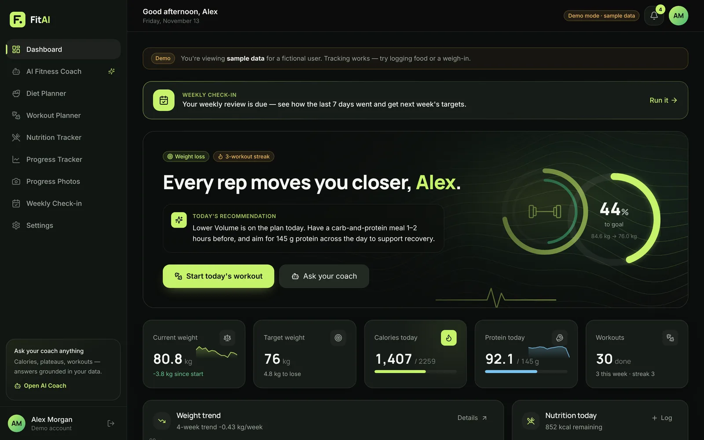

> FitAI gives general fitness and wellness guidance. It is not a medical device and does not diagnose conditions.

## Contents

- [Highlights](#highlights)
- [Screenshots](#screenshots)
- [Features](#features)
- [How it works](#how-it-works)
- [Tech stack](#tech-stack)
- [Run it locally](#run-it-locally)
- [Tests and code quality](#tests-and-code-quality)
- [Project structure](#project-structure)
- [Documentation](#documentation)

## Highlights

- **Grounded AI coach.** Gemini function calling over 12 backend tools (targets, weight trend, meal plans, workouts, food search). Numbers come from Python, not from the model. Without an API key, a clearly labelled rule-based coach uses the same tools.
- **Facts first, wording second.** The weekly check-in computes the score, wins and targets in code; the LLM only writes the sentences, with a rules engine as fallback.
- **Built for Indian users.** About 200 home-style dishes (jolada rotti, girmit, dosa, dal, biryani…) searchable by regional names and common misspellings, logged by household portion: 1 roti, 1 katori, 1 dosa. Dates follow the user's own time zone.
- **Security taken seriously.** Email verification and a one-time code on every login, codes hashed with HMAC and limited to 5 attempts, password changes sign out every other device, per-IP rate limits, API keys hidden from every logged error, and progress photos stripped of GPS and camera data and visible only to their owner.
- **Production-minded.** 95 tests run on SQLite and PostgreSQL in GitHub Actions, linted with Ruff and ESLint. Production mode refuses to start with unsafe settings. Each demo visitor gets a private sandbox that deletes itself.

## Screenshots

| | |
|---|---|
| 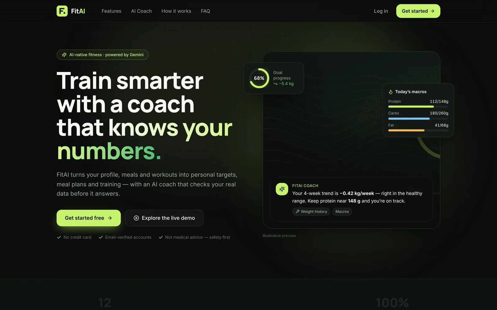 | 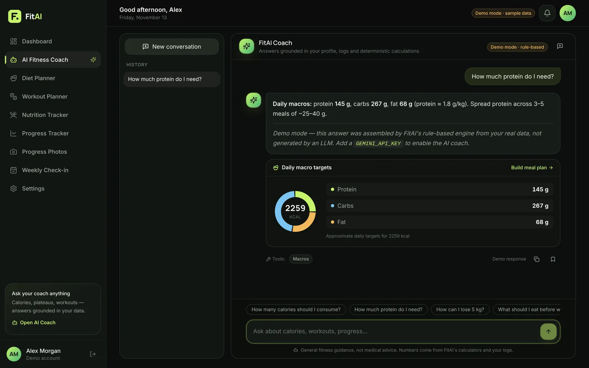 |
| **Landing page** | **AI coach** with a structured answer |
| 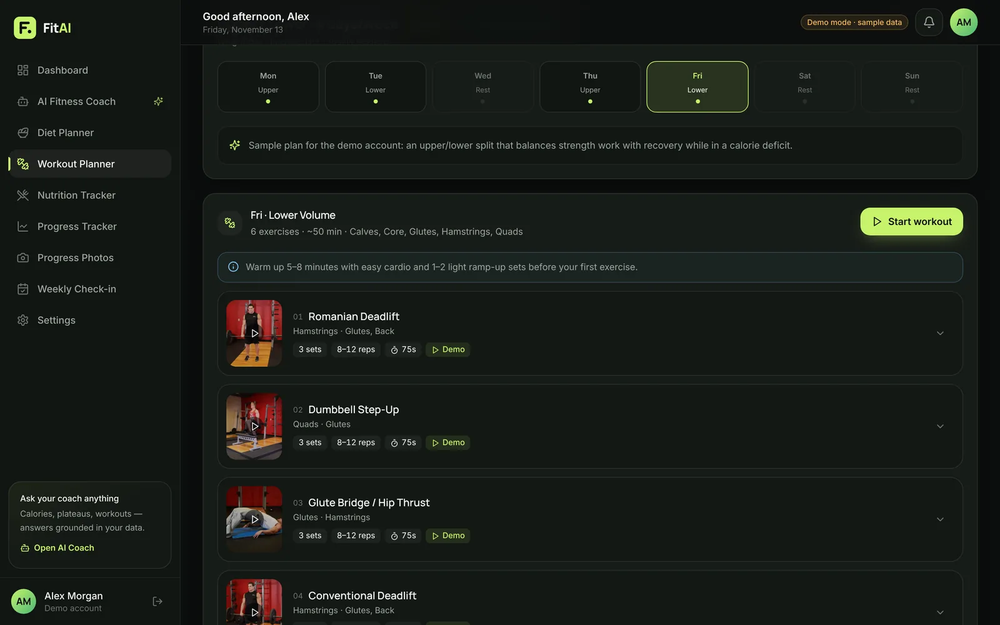 | 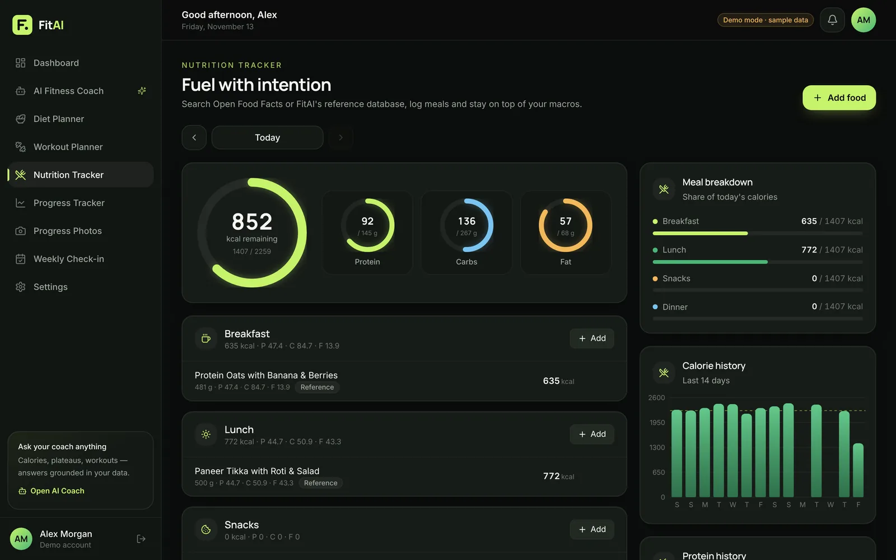 |
| **Workout planner** with exercise demos | **Nutrition tracker** |
| 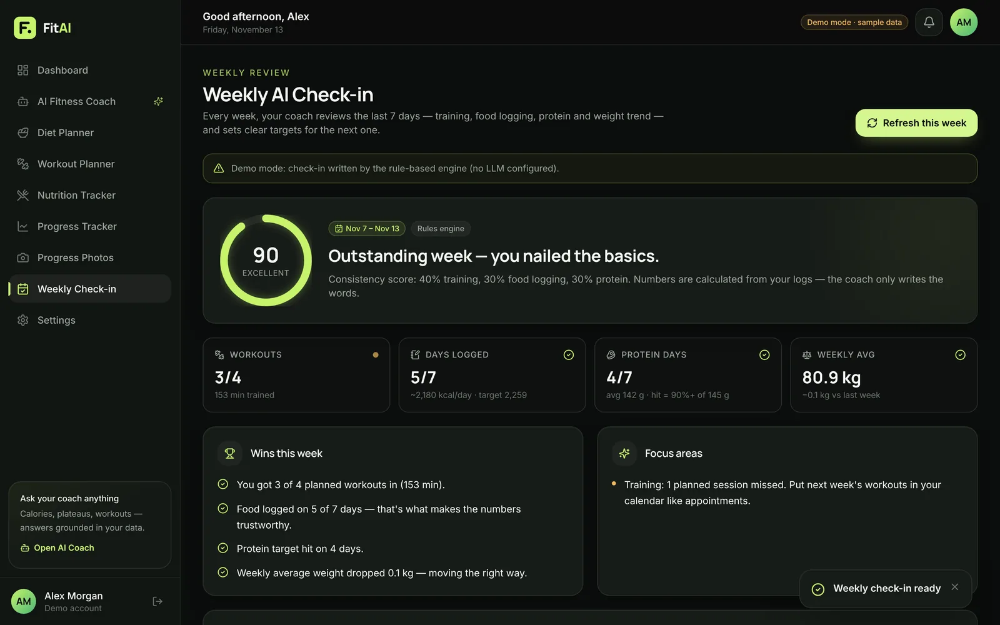 | 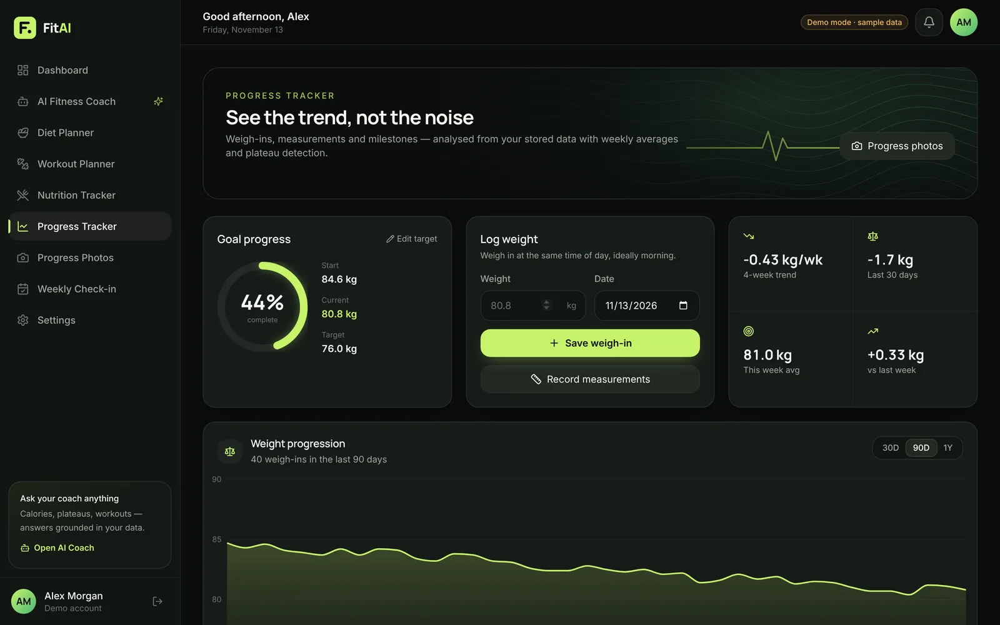 |
| **Weekly AI check-in** | **Progress tracker** |

<p align="center">
  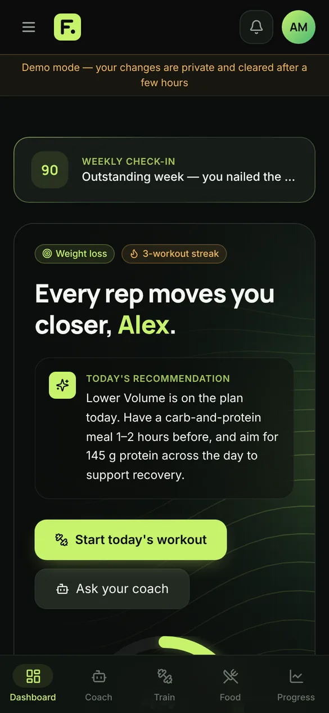
  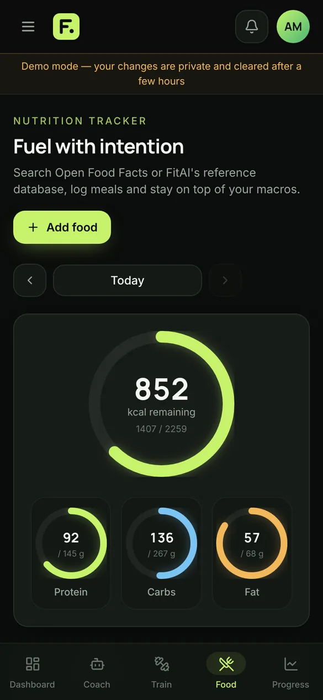
  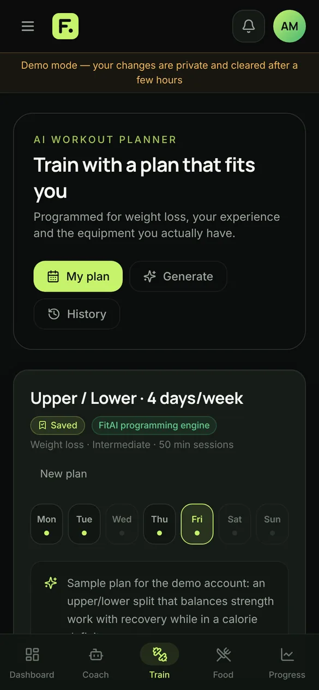
</p>

## Features

| Area | What it does |
|---|---|
| **Accounts** | Registration with email verification, a 6-digit code on every login, forgot password, JWT sessions, account deletion |
| **Onboarding** | Six guided steps (metric or imperial) with a live preview of BMR, TDEE, calorie target and macros |
| **Dashboard** | Goal-progress ring, daily AI recommendation, weight, calorie and protein charts, streaks, challenges and achievements |
| **AI coach** | Persistent conversations, tool calling, structured answer cards (macros, weight trend, workouts, foods), suggested prompts |
| **Diet planner** | 3–5 meal plans matched to calories, macros, diet type, restrictions and budget; swap foods, regenerate meals, mark meals eaten |
| **Workout planner** | Push/Pull/Legs, Upper/Lower, Full Body, beginner, muscle-building, fat-loss and custom splits; start-and-finish photo demos for 62 of 63 exercises; guided sessions with set tracking and a rest timer |
| **Nutrition tracker** | Open Food Facts search with an offline reference database, the Indian food library, custom foods, 14-day history |
| **Progress** | Weight and body measurements, weekly averages, a 4-week regression trend, plateau detection, milestones |
| **Progress photos** | Private front, side and back photos with a timeline and a before/after comparison slider |
| **Weekly check-in** | 0–100 consistency score from workouts, logging days, protein days and weight change, with next week's targets |
| **Demo mode** | One click gives a private copy of a 9-week sample account, deleted after 6 hours |

## How it works

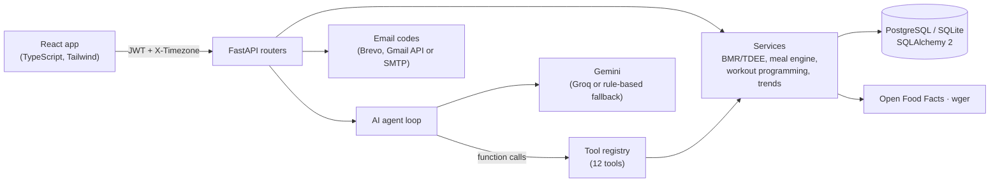

The browser never holds an API key. Every AI answer that contains a number is produced by a tool call into the same services the rest of the app uses, so the coach and the dashboard always agree. More detail is in [docs/PROJECT_ARCHITECTURE.md](docs/PROJECT_ARCHITECTURE.md).

## Tech stack

| Layer | Technology |
|---|---|
| Frontend | React 18, TypeScript, Vite 5, Tailwind CSS 3, Recharts, React Router 6 |
| Backend | Python 3.12, FastAPI, Pydantic v2, SQLAlchemy 2, PyJWT, bcrypt, Pillow, httpx |
| Database | PostgreSQL on Neon (production), SQLite (local development) |
| AI | Google Gemini REST API with function calling; Groq and a rule-based engine as fallbacks |
| Data | Open Food Facts, wger, free-exercise-db (public domain) |
| Quality | pytest, Ruff, ESLint, GitHub Actions |
| Deployment | Render (`render.yaml`), Vercel (`frontend/vercel.json`), Docker Compose |

## Run it locally

You need Python 3.10+ and Node.js 18+ (`brew install python@3.12 node` on macOS).

```bash
git clone https://github.com/kunalbhoomaraddi-cpu/fitai.git
cd fitai
./start.sh
```

Open **http://localhost:5173** and click **Explore the demo**, or create an account. On first run, `start.sh` creates `backend/.env` with a random secret. Add a free [Gemini key](https://aistudio.google.com/apikey) there to switch the coach from demo mode to Gemini. Without email settings, login codes are printed in the terminal.

Full instructions: [docs/LOCAL_SETUP.md](docs/LOCAL_SETUP.md) · every setting: [docs/ENVIRONMENT_CONFIGURATION.md](docs/ENVIRONMENT_CONFIGURATION.md)

## Tests and code quality

```bash
./scripts/test-all.sh
```

This runs the same checks as CI: Ruff and 95 pytest tests for the backend, and ESLint, strict TypeScript and a production build for the frontend. See [docs/TESTING_GUIDE.md](docs/TESTING_GUIDE.md) for what each test file covers.

## Project structure

```
fitai/
├── backend/
│   ├── app/
│   │   ├── routers/     HTTP endpoints: auth, coach, diet, workouts, nutrition, progress, photos, check-ins…
│   │   ├── services/    business logic: calculations, meal engine, workout programming, trends, email
│   │   ├── ai/          provider abstraction (Gemini, Groq, mock), prompts, agent loop
│   │   ├── tools/       functions the AI coach can call
│   │   ├── models/      SQLAlchemy tables
│   │   ├── schemas/     Pydantic request and response models
│   │   ├── data/        foods, Indian dishes, meal templates, exercise library, quotes
│   │   └── utils/       time zones, rate limiting, HTTP helpers
│   ├── tests/           95 pytest tests
│   └── requirements.txt · requirements-dev.txt · ruff.toml
├── frontend/
│   ├── src/             pages, components, layouts, hooks, services, context
│   ├── public/images/   original artwork and exercise demo frames
│   └── package.json · eslint.config.js · vercel.json
├── docs/                guides and screenshots
├── scripts/             dev, test and reset helpers
├── .github/workflows/   CI
├── render.yaml          backend deployment blueprint
├── docker-compose.yml
└── start.sh             one-command local start
```

## Documentation

| Guide | What's inside |
|---|---|
| [Local setup](docs/LOCAL_SETUP.md) | Installing, running and troubleshooting |
| [Environment configuration](docs/ENVIRONMENT_CONFIGURATION.md) | Every setting and where keys go |
| [Architecture](docs/PROJECT_ARCHITECTURE.md) | System diagram, AI tool calling, database design, security |
| [API reference](docs/API_DOCUMENTATION.md) | All endpoints (interactive docs at `/docs` when running) |
| [Testing](docs/TESTING_GUIDE.md) | Running tests and what they cover |
| [Deployment](docs/DEPLOYMENT_GUIDE.md) | Neon, Render, Vercel and Docker |
| [Image credits](docs/IMAGE_CREDITS.md) | Licences for artwork and photos |
| [Changelog](docs/CHANGELOG.md) | What was built, phase by phase |

## Author

Built by **Kunal** ([@kunalbhoomaraddi-cpu](https://github.com/kunalbhoomaraddi-cpu)).
