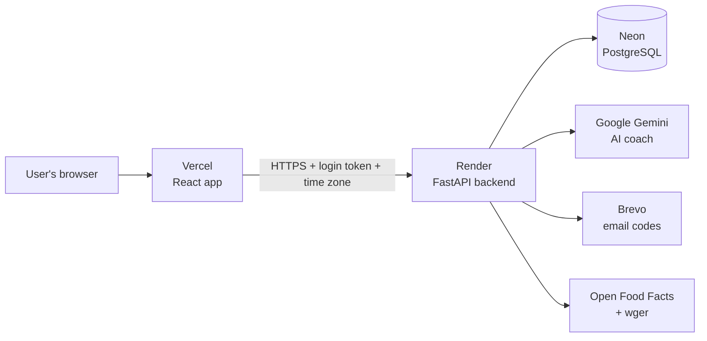

# FitAI — Complete Project Documentation

**Author:** Kunal Bhoomaraddi · **As of:** 13 November 2026

| | |
|---|---|
| **Live app** | https://fitai-app-pink.vercel.app (click **Explore the demo**, no sign-up needed) |
| **Source code** | https://github.com/kunalbhoomaraddi-cpu/fitai (public) |
| **Backend API** | https://fitai-api-nmtc.onrender.com/api/health |
| **Status** | Live in production · 95 automated tests passing on every push |

---

## Contents

1. [Project summary](#1-project-summary)
2. [Architecture and tech stack](#2-architecture-and-tech-stack)
3. [Phase 0: the first version](#3-phase-0-the-first-version)
4. [Feature additions](#4-feature-additions)
5. [Research, design review and quality audit](#5-research-design-review-and-quality-audit)
6. [Phase 1: production readiness](#6-phase-1-production-readiness)
7. [Going live](#7-going-live)
8. [Security](#8-security)
9. [Repository, CI and documentation](#9-repository-ci-and-documentation)
10. [Testing](#10-testing)
11. [Demo script for the screen share](#11-demo-script-for-the-screen-share)
12. [Next steps before many users](#12-next-steps-before-many-users)
13. [Timeline of the whole project](#13-timeline-of-the-whole-project)

---

## 1. Project summary

FitAI is an AI fitness coach that checks the user's real numbers before it answers. It turns a person's profile, meals, workouts and weigh-ins into calorie and macro targets, meal plans, training programmes and weekly reviews.

**The core idea:** the AI never guesses numbers. It calls backend tools that run proven formulas on the user's own data, then explains the result in plain language.

**Goals set at the start**
- A working MVP on a short timeline, without unnecessary complexity.
- A premium dark interface: charcoal background with an electric lime accent (`#C6F36B`).
- A demo mode that works without any API keys.
- Free tools only: Gemini free tier, Open Food Facts, wger, free hosting.

**Where it stands today**
- Live on the internet with real accounts, email login codes and a working AI coach.
- Built for Indian users: about 200 home-style dishes, household portions and India-time dates.
- Code on GitHub with automated tests, linting and clear documentation.

---

## 2. Architecture and tech stack



**How a coach question works:** the browser sends the question to the backend. The agent loop asks Gemini, Gemini requests a tool (for example "weight history"), and the backend runs that calculation on the user's data. Gemini then explains the result, and the answer appears as a structured card.

| Layer | Technology |
|---|---|
| Frontend | React 18, TypeScript, Vite 5, Tailwind CSS 3, Recharts, React Router 6, Lucide icons |
| Backend | Python 3.12, FastAPI, Pydantic v2, SQLAlchemy 2, PyJWT, bcrypt, Pillow, httpx |
| Database | PostgreSQL on Neon (production), SQLite (local development) |
| AI | Google Gemini with function calling; Groq and a rule-based engine as fallbacks |
| External data | Open Food Facts (food), wger and free-exercise-db (exercises), Unsplash (photos) |
| Email | Brevo HTTPS API (live); Gmail API and SMTP supported |
| Hosting | Vercel (frontend), Render (backend, Singapore region), Neon (database) |
| Quality | pytest, Ruff, ESLint 9, GitHub Actions |
| Packaging | Docker Compose, `start.sh` one-command local start |

**Code layout**

| Folder | What's inside |
|---|---|
| `backend/app/routers/` | HTTP endpoints: auth, coach, diet, workouts, nutrition, progress, photos, check-ins, settings |
| `backend/app/services/` | Business logic: calculations, meal engine, workout programming, trends, email, demo |
| `backend/app/ai/` | AI providers (Gemini, Groq, mock), prompts, agent loop |
| `backend/app/tools/` | The 12 tools the AI coach can call |
| `backend/app/models/`, `schemas/` | Database tables and request/response shapes |
| `backend/app/data/` | Food database, Indian dishes, meal templates, exercise library, quotes |
| `backend/app/utils/` | Time zones, rate limiting, key hiding, HTTP helpers |
| `frontend/src/` | Pages, components, layouts, hooks, services, context |
| `docs/` | Guides, changelog, screenshots |
| `scripts/` | Dev, test, reset and setup helpers |

---

## 3. Phase 0: the first version

The first version was delivered as a ZIP with a README, an example settings file, Docker setup and tests. It then ran locally on the Mac with a Gemini key.

| Feature | What it does |
|---|---|
| **Accounts** | Registration, email verification with a 6-digit code, a one-time code on every login, JWT sessions, account deletion |
| **Onboarding** | Six guided steps (metric or imperial) with a live preview of BMR, TDEE, calorie target and macros |
| **Calculations** | Mifflin-St Jeor BMR, activity multipliers, safe deficit and surplus caps, calorie floor, macro split, BMI |
| **Dashboard** | Goal-progress ring, daily AI recommendation, weight, calorie and protein charts, streaks, challenges, achievements |
| **AI coach** | Persistent conversations, Gemini tool calling over 12 backend tools, structured answer cards, suggested prompts |
| **Diet planner** | 3–5 meal plans matched to calories, macros, diet type, restrictions and budget; swap foods; regenerate meals; mark meals eaten |
| **Workout planner** | Push/Pull/Legs, Upper/Lower, Full Body, beginner, muscle-building, fat-loss and custom splits matched to equipment; guided sessions with set tracking and a rest timer |
| **Nutrition tracker** | Open Food Facts search with an offline reference database, custom foods, 14-day history |
| **Progress tracker** | Weight and body measurements, weekly averages, 4-week regression trend, plateau detection, milestones |
| **Demo mode** | A clearly labelled 9-week sample account; the coach falls back to a rule-based engine without API keys |

**Moving to GitHub:** the project moved to `~/Developer/FitAI` (old zips archived in `~/Developer/FitAI-archive`) and was backed up to a GitHub repository. First commit: `b983d86`.

---

## 4. Feature additions

### 4.1 Forgot password and weekly AI check-in (commit `a582d65`)

**Forgot password**
- The user enters their email and receives a reset code.
- If the email isn't registered, the page says so instead of pretending to send a code.
- Codes are hashed, limited to 5 attempts, expire after 15 minutes, and can be resent after 60 seconds.
- Changing the password signs out every other device. Each login token records when it was issued, and older tokens are rejected.

**Weekly AI check-in**
- A 0–100 consistency score: 40 points for workouts, 30 for logging on 5 days, 30 for hitting protein on 4 days.
- Shows the week's wins, weight change, warnings (such as losing weight too fast) and next week's targets.
- The facts are calculated in code; the AI only writes the wording, with a rules engine as fallback.

### 4.2 Progress photos (commit `ca0828f`)

- Front, side and back photos with a timeline and a before/after comparison slider.
- Photos are straightened automatically, stripped of GPS and camera data, and resized (1600 px full size, 480 px thumbnail).
- Stored privately and served only to their owner through a signed-in request.
- Bug fixed after testing: the front/side/back switch wasn't changing the photo.

### 4.3 Indian food library and exercise demos (commit `dd25808`)

**Indian food**
- About 200 home-style dishes (jolada rotti, girmit, dosa, dal, biryani and more).
- Search works with regional names and common misspellings (fuzzy matching).
- Short words match whole words only, so "dal" doesn't match "dalimbe".
- Portions are household units shown as chips: 1 roti, 1 katori, 1 dosa, with a count stepper.

**Exercise demos**
- Start-and-end position photos with step-by-step cues for 62 of 63 exercises.
- 21 exercises were added to the library; side plank is timed, and chest dips are left out for beginners.

---

## 5. Research, design review and quality audit

**Competitor research:** similar fitness and nutrition apps were reviewed, and improvements were suggested. From those, the Indian food library and the exercise demos (section 4.3) were chosen and built.

**Developer review:** a list of pending work was drawn up and split into Phase 1, 2 and 3. Phase 1 became section 6.

**Redesign attempt, rejected**
- A complete new light "Training log" design was made in Figma and in code.
- After trying it, the decision was that the original dark design was better.
- The project was restored to the original design from Git. Rule kept since then: protect the original dark look.

**Quality audit of the restored design (laptop and phone)**

| Problem found | Fix |
|---|---|
| Nutrition page wider than the phone screen (414 px on a 390 px phone) | Grid columns allowed to shrink |
| Progress page wider than the phone screen (546 px) | Grid fixes, scrollable weekly table |
| "Start workout" button cut off | Card header wraps on small screens |
| Chart axes showing odd decimal values | Rounded "nice" tick values, whole-number axes, legend added |
| Achievement pop-ups and confetti on every demo visit | Turned off for demo accounts |
| Blank landing sections when animations didn't fire | 2.5-second fallback shows them |
| Wrong plurals ("1 workouts", "1 days") | Proper singular and plural text |
| Spelling | Checked with codespell and a spell checker: no visible spelling mistakes |

---

## 6. Phase 1: production readiness

Commit `f418c6d`, "Phase 1 updates" (62 files).

### 6.1 Correct dates in the user's time zone
- **Problem:** servers run on UTC, so a meal logged in India at 12:30 a.m. counted toward the previous day.
- **Fix:** the browser sends its time zone with every request; FitAI saves it on the account; every "today", "this week" and streak uses the user's local date. India is the default.
- Chrome still sends the old name "Asia/Calcutta", so legacy names are translated.

### 6.2 Private demo copies
- **Problem:** every "Try the demo" click reset one shared account, so a second visitor could sign the first one out.
- **Fix:** each click creates a private copy, deleted after 6 hours, with at most 100 at once. Visitors can't see each other's changes, and the demo email domain is reserved.

### 6.3 Code quality tools
- ESLint 9 for the frontend and Ruff for the backend, both passing.
- One real bug found and fixed by the linter, on the Progress Photos page.

### 6.4 Deployment setup
- `render.yaml` blueprint for the backend and `frontend/vercel.json` for the frontend.
- Production safety check: the backend refuses to start with a weak secret, a SQLite database, no email sender or no public website address.
- Neon's `postgres://` addresses are converted to the right driver automatically.
- Real visitor IP addresses are read behind Render's proxy, so per-IP rate limits work.
- A friendly "FitAI is waking up" message replaces a technical error while the free server starts.

---

## 7. Going live

| Step | Service | Result |
|---|---|---|
| 1 | Replaced every key and password shared earlier in chats (Gemini, Neon, JWT secret, Gmail app password) | Old keys useless |
| 2 | **Brevo**: signed up, verified the sender address, created an API key | Email ready |
| 3 | **Render**: deployed the backend from the GitHub blueprint | https://fitai-api-nmtc.onrender.com |
| 4 | **Vercel**: deployed the frontend from the `frontend` folder | https://fitai-app-pink.vercel.app |
| 5 | Connected them by adding the Vercel address to the backend's allowed origins (`CORS_ORIGINS`) | Login works online |

**Problems hit and how they were solved**

| Problem | Cause | Solution |
|---|---|---|
| Gmail email couldn't work on Render | Render's free plan blocks email (SMTP) ports | Added Brevo's web API, which sends over HTTPS |
| Vercel said the name "fitai" was taken | A failed first attempt had created a project | Named the project `fitai-app` |
| "We couldn't send your login code" | The pasted Brevo key ended with an invisible line break | Code now trims every pasted setting; key replaced |
| That error printed the full key in the logs | Network errors included request headers | Keys now show as `[hidden]` in every logged error; the exposed key was deleted and replaced |
| Codes sent but not received | Gmail was holding mail from the brand-new Brevo account | Built a Gmail API backup path; Brevo began delivering in real time once its warm-up period ended, so it stays the live method |
| Food and workout photos missing online | Photos existed only on the Mac, not in Git | Compressed from 14.5 MB to 6.8 MB and added to the repo |

---

## 8. Security

**Accounts and sessions**
- Passwords hashed with bcrypt; login tokens are signed JWTs.
- Email verification at sign-up and a 6-digit code on every login.
- All codes stored as HMAC hashes, never in plain text; 5 attempts, 15-minute expiry, 60-second resend cooldown.
- Changing or resetting a password signs out every other device.
- Per-IP rate limiting on sign-in, codes and the demo.

**Data**
- Every request checks that data belongs to the signed-in user (tested: users can't read each other's data).
- Progress photos stripped of GPS and camera data, served only to their owner.

**Secrets**
- Secrets live only in the Render and Vercel dashboards and in the local `backend/.env`, which Git ignores.
- The whole Git history was scanned: no keys, passwords, `.env` files or database files were ever pushed.
- Keys shared in chats early on were all replaced. The one key printed in logs was deleted and replaced.
- API keys are hidden as `[hidden]` in every logged error, and pasted settings are trimmed.
- The production safety check stops the server from starting with unsafe settings.

---

## 9. Repository, CI and documentation

**Repository:** https://github.com/kunalbhoomaraddi-cpu/fitai (made public after checking the history for secrets)

```
fitai/
├── backend/            FastAPI app + 95 tests
├── frontend/           React app
├── docs/               guides, changelog, screenshots
├── scripts/            dev, test, reset and setup helpers
├── .github/workflows/  automated checks
├── render.yaml         backend deployment
├── docker-compose.yml  single-server option
└── start.sh            one-command local start
```

**Documentation**
- **README:** live link, highlights, screenshots (laptop and phone), architecture diagram, tech stack, how to run it.
- `docs/LOCAL_SETUP.md`, `ENVIRONMENT_CONFIGURATION.md`, `PROJECT_ARCHITECTURE.md`, `API_DOCUMENTATION.md`
- `docs/TESTING_GUIDE.md`, `DEPLOYMENT_GUIDE.md`, `IMAGE_CREDITS.md`, `CHANGELOG.md`

**Automated checks (GitHub Actions):** every push runs Ruff, the 95 backend tests on SQLite and again on PostgreSQL 16, then ESLint, the TypeScript check and a production build. All 5 runs so far passed, in about a minute each.

**Commit history (newest first)**

| Commit | Change |
|---|---|
| `81f00d1` | Final cleanup: live link, changelog, updated docs, photos in repo |
| `e099518` | Send email codes through the Gmail API (backup path) |
| `e9371bd` | Trim pasted settings and hide keys in error logs |
| `2392f99` | Make test script executable |
| `241e0b1` | Polish repo: new README with screenshots, docs folder, CI, small UI fixes |
| `f418c6d` | Phase 1 updates: time zones, private demo copies, linting, deployment setup |
| `dd25808` | Indian food library and exercise demos |
| `ca0828f` | Progress photos |
| `a582d65` | Forgot password and weekly AI check-in |
| `b983d86` | First version: AI coach, diet and workout planners, email verification |

---

## 10. Testing

| Check | Result |
|---|---|
| Backend tests on SQLite | 95 / 95 passed |
| Backend tests on PostgreSQL 16 (same as Neon) | 95 / 95 passed |
| Ruff (backend) and ESLint (frontend) | No problems |
| TypeScript check and production build | Passed |
| Browser tests: login code, forgot password, weekly check-in, progress photos, Indian food, exercise demos | All passed |
| All 13 pages at laptop and phone size (26 screens) | No errors, nothing cut off |
| Live site | Website, backend, database, AI coach, email codes, photos and demos working |

**What the backend tests cover**

| Test file | Covers |
|---|---|
| `test_calculations.py` | BMR, TDEE, deficit and surplus caps, calorie floor, macros, BMI, streak rule |
| `test_api.py` | Sign-up, login, protected pages, profile, dashboard, nutrition (including user isolation), weight, diet and workout generation, coach |
| `test_verification.py`, `test_login_otp.py` | Email and login codes: wrong codes, lockout, single use, resend cooldown, hashing |
| `test_password_reset.py` | Reset flow, unknown emails, limits, other sessions signed out |
| `test_checkins.py` | Weekly score, targets, warnings, AI wording with fallback |
| `test_photos.py` | Upload checks, GPS stripping, thumbnails, owner-only access |
| `test_indian_foods.py`, `test_exercise_demos.py` | Regional names, misspellings, portions; every exercise has a demo |
| `test_timezone.py` | India just after midnight on a UTC server, saved zone, legacy names |
| `test_demo.py` | Private demo copies, expiry, reserved email domain |
| `test_deploy_config.py` | Production checks, trimming, hidden keys, Brevo and Gmail email |
| `test_ai_provider.py`, `test_real_llm_paths.py` | AI provider choice and a simulated tool-calling round trip |

Run everything locally with `./scripts/test-all.sh`.

---

## 11. Demo script for the screen share

About 10–12 minutes. Open the site a minute early so the free server is awake.

1. **Landing page** (https://fitai-app-pink.vercel.app): the idea in one line, then **Explore the demo**, which needs no sign-up.
2. **Dashboard**: goal ring, today's recommendation, charts, streaks.
3. **AI Fitness Coach**: ask "How much protein do I need?" and point out the tool card; the number comes from a calculation, not a guess.
4. **Diet Planner**: an Indian meal plan; swap a food, mark a meal eaten.
5. **Workout Planner**: open a **Demo**, then **Start workout** to show set tracking and the rest timer.
6. **Nutrition Tracker**: search "jolada rotti" and add 2 rotis.
7. **Weekly Check-in**: run it and explain the score.
8. **Real account**: log out, log in with your email, and show the 6-digit code arriving.
9. **GitHub**: the README, the green Actions runs, `docs/CHANGELOG.md`.
10. **Close**: the next steps (section 12).

**Likely questions**

| Question | Answer |
|---|---|
| Why doesn't the AI make up numbers? | It calls backend tools that calculate from the user's data; the AI only explains |
| What if Gemini is down? | It falls back to a fallback model, then a rule-based coach that uses the same tools |
| How is data protected? | Hashed passwords and codes, login codes, owner-only data, photos without location data, keys never in Git |
| Why is the first load slow? | The free Render server sleeps after 15 idle minutes; a paid plan removes this |
| Can it handle many users? | Yes for a pilot; section 12 lists what to add before scaling |

---

## 12. Next steps before many users

**Must do**
1. Privacy policy and terms pages: health data is involved, and India's DPDP Act, 2023 applies.
2. Database backups and a tested restore plan.
3. Error monitoring (Sentry) and uptime monitoring.
4. Proper database migrations with Alembic.

**Should do**
5. Browser tests (Playwright) in the repo and in CI.
6. Login tokens in secure cookies, plus a Content-Security-Policy header.
7. Dependabot for dependency updates (npm reported 11 known vulnerabilities in dependencies).
8. Stricter TypeScript types for API responses.
9. Move progress photos to object storage.
10. Shared rate limiting (Redis) if the backend runs on more than one server.

**Product**
11. Own domain (for example `fitai.in`) for a professional address and more reliable email.
12. Paid hosting to remove the cold start.
13. Installable phone app (PWA) and reminders.
14. Accessibility review, Hindi and Kannada versions, usage analytics.

**AI**
15. Per-user limits on AI calls.
16. A test set of coach questions to check quality when prompts or models change.
17. Guards against attempts to make the coach give unsafe advice.

---

## 13. Timeline of the whole project

| When | Milestone |
|---|---|
| 13 Nov 2026 | Final cleanup: live link, changelog, photos in repo (`81f00d1`) |
| 13 Nov 2026 | Live on Vercel, Render, Neon and Brevo; key redaction and trimming; Gmail API backup |
| 13 Nov 2026 | Repo polished and made public; GitHub Actions added |
| Nov 2026 | Phase 1: time zones, private demo copies, linting, deployment setup |
| Nov 2026 | Quality audit of the restored dark design on laptop and phone |
| Nov 2026 | Light redesign tried in Figma and code, rejected, original design restored |
| Nov 2026 | Competitor research; Indian food library and exercise demos |
| Nov 2026 | Progress photos |
| Nov 2026 | Forgot password and weekly AI check-in |
| Nov 2026 | Project moved to `~/Developer/FitAI` and pushed to GitHub |
| Nov 2026 | First version built and running locally with Gemini |
